# 01 · Cómo está construido el proyecto

> **En pocas palabras:** NexoLSC tiene dos partes. Una es la **página web**, donde escribes o dices
> una palabra y el avatar la deletrea. La otra es el **taller de contenido**, donde se crean los
> avatares en Blender y se les enseñan las 27 letras. La página no necesita servidor: todo funciona en
> el navegador.

Si una palabra técnica no te queda clara, búscala en el [glosario](17-glosario.md).

## Las dos partes

1. **La página web** (hecha con React y three.js). Recibe el texto o la voz, lo convierte en una
   lista de letras y hace que el avatar 3D las señe una por una. No usa servidor: las letras están
   escritas en el código, los avatares son archivos `.glb` y el navegador se encarga de reconocer la voz.
2. **El taller de contenido** (Blender). Ahí se crean los avatares y sus 27 letras. Cada letra es una
   **animación dentro del archivo de Blender** que se perfecciona a mano y se exporta para la página.

La idea principal es separar lo que **va a cambiar** (cómo se pasa de texto a señas, qué avatar se
usa) de lo que **se queda igual** (el reproductor). Así, cuando el proyecto pase de deletrear letras a
señar palabras completas, o cuando se cambie de avatar, no hay que rehacer el reproductor ni volver a
animar.

## Las piezas de la página web

| Pieza | Nombre en el código | Qué hace |
|---|---|---|
| Limpiar el texto | `normalizeText` | Pasa el texto a mayúsculas, quita tildes (menos la Ñ) y marca las pausas entre palabras |
| Diccionario de señas | `SignRepository` | Guarda las señas y las entrega cuando se piden. Hoy tiene las 27 letras |
| Armar la lista de señas | `buildQueue` | Busca la seña de cada letra y arma la lista en orden |
| Reproductor | `SignPlayer` | Lleva el reloj: sabe qué letra toca y cuánto le falta |
| Mezclador de animaciones | `ClipDriver` | Le dice al avatar qué pose mostrar en cada momento |
| Fondo del escenario | `StageBackground` | Pone la foto desenfocada detrás del avatar |

Estas piezas existen para que el proyecto pueda crecer sin romperse: en la fase 2 solo hay que cambiar
«Armar la lista de señas» para que busque palabras completas antes de deletrear, y el diccionario puede
pasar de estar en el código a estar en internet sin tocar lo demás.

## Cómo se crean los avatares y sus letras (taller de contenido)

El original de cada letra es su animación en Blender: se abre, se retoca a mano y se exporta. El generador
de avatares no sobrescribe un avatar que ya existe, así que las letras no se pierden. Más detalle en
[06-animation-clips.md](06-animation-clips.md).

## Del texto al avatar, paso a paso

## Reglas que sigue el diseño

1. **El núcleo no depende de la pantalla ni del 3D.** La parte que limpia el texto, arma la lista y
   lleva el reloj (`src/core`) funciona sola. Por eso se puede probar sin abrir el navegador (hoy tiene
   15 pruebas automáticas).
2. **El reproductor manda en el tiempo.** El reproductor tiene su propio reloj. El avatar solo le
   pregunta, en cada cuadro, «¿qué pose muestro ahora?». Gracias a eso, pausar, cambiar la velocidad,
   saltar a una letra o repetir son cosas sencillas que siempre dan el mismo resultado.
3. **La pantalla se actualiza poco; el avatar, mucho.** Los botones y la línea de letras solo se
   redibujan cuando cambia la letra (unas pocas veces por segundo). El avatar se actualiza 60 veces por
   segundo sin pasar por los botones.
4. **Todo es una «seña».** Una letra es una seña de tipo «letra». Las palabras, los números y los gestos
   de la cara usarán el mismo formato en el futuro (ver [08-modelo-datos-letras.md](08-modelo-datos-letras.md)).
5. **Las letras se perfeccionan en Blender y los avatares se pueden cambiar.** Todos los avatares cumplen
   las mismas reglas (el mismo tipo de esqueleto y las mismas animaciones con los mismos nombres), así que
   las animaciones se pueden copiar de un avatar a otro. Se registran en
   `src/avatar/avatars.ts` y se comparan con el selector.
6. **Si algo falta, la app sigue funcionando.**
   - Sin ningún avatar: muestra la letra en grande con la descripción de la mano.
   - Sin la animación de una letra: el avatar se queda en reposo y la letra aparece marcada como
     «animación pendiente».
   - Sin foto de fondo: el escenario queda de un color liso.
   - Sin reconocimiento de voz en el navegador: lo explica y te invita a escribir.

## ¿Hace falta un servidor o una base de datos?

**Por ahora, no.** Así queda cada herramienta:

| Herramienta | ¿Se usa hoy? | Por qué | ¿Cuándo se necesitaría? |
|---|---|---|---|
| **Node.js** | Solo para **trabajar en el proyecto** (arrancar, compilar y probar) | La página no tiene código de servidor | Ya se usa así |
| **Express** u otro servidor | **No** | No hay cuentas, datos privados ni nada que esconder | Más adelante: un panel para administrar las señas, revisión por personas sordas, estadísticas de uso, voz en la nube o traducción |
| **PostgreSQL** (base de datos) | **No** | 27 letras caben en un archivo del código | Cuando haya cientos de señas, con variantes por región y su historial de revisión |

**Publicar la página:** `npm run build` crea la carpeta `dist/` con la página lista. Se puede subir a
cualquier servicio de páginas estáticas (Vercel, Netlify, GitHub Pages, Cloudflare Pages). Tiene que
usar **HTTPS** (el candado del navegador); si no, el micrófono no funciona.

## Decisiones tomadas

| # | Qué se decidió | Qué se descartó | Por qué |
|---|---|---|---|
| A1 | Una página sin servidor | Montar un servidor desde el principio | Menos piezas; hoy nada lo necesita |
| A2 | Un solo archivo `.glb` por avatar con todas sus letras | Un archivo por letra | Se descarga una vez y el cuerpo no se repite (ver [06](06-animation-clips.md)) |
| A3 | El reproductor lleva su propio reloj | Esperar a que cada animación avise que terminó | Con avisos, pausar, saltar y cambiar la velocidad se vuelve frágil |
| A4 | Las transiciones entre letras se calculan solas | Animar a mano el paso de cada letra a cada otra | Serían 27 × 27 = 729 transiciones |
| A5 | El estado vive dentro del reproductor | Usar librerías extra de estado (Redux, Zustand) | El estado es pequeño; no hace falta otra librería |
| A6 | Voz con el reconocimiento del navegador | Un servicio de voz pagado en la nube | Gratis y sin claves; se puede cambiar después |
| A7 | Primera versión de las letras generada desde datos | Animar las 27 letras a mano desde cero | Se tuvo una base completa en poco tiempo; ya se probó con dos avatares |
| A9 | Desde la v0.5.0, las letras solo viven en Blender y se perfeccionan a mano (el `.blend` es el original) | Seguir corrigiendo con números en un archivo de datos | Es más rápido e intuitivo ver y mover la mano; un solo original evita que una copia borre la otra |
| A8 | Avatares creados por programa con MPFB 2 (licencia libre CC0) | Modelos de internet o creados con IA | Licencia libre, se pueden volver a crear y tienen dedos y cara. Las mallas hechas con IA suelen pegar los dedos |
