# 05 · El esqueleto del avatar

> **En pocas palabras:** el avatar tiene un **esqueleto**, como una persona. En Blender ese esqueleto
> tiene muchos controles para posarlo con comodidad (930 huesos). Al exportarlo para la web solo se
> guardan los huesos que mueven el cuerpo (181). El navegador nunca ve los controles, solo el resultado.

«Rigging» es el trabajo de ponerle un esqueleto a un modelo 3D para poder moverlo. En este proyecto se usa
**Rigify**, el sistema de esqueletos que viene con Blender.

## Dos esqueletos, dos trabajos

- **En Blender**, las letras se posan a mano moviendo los controles (ver [06](06-animation-clips.md)).
  Cada letra tiene fotogramas clave solo en 50 controles.
- **Al exportar** (`tools/blender/export_avatar.py`), Blender calcula dónde queda cada hueso que mueve el
  cuerpo y guarda solo eso. El navegador recibe 181 huesos en vez de 930.

Probado con Blender 5.2 en los dos avatares MPFB: un esqueleto de 181 huesos y 28 animaciones (reposo + 27
letras).

## Los huesos que mueven el cuerpo

| Parte del cuerpo | Huesos (nombre en Rigify) | Para qué sirven en LSC |
|---|---|---|
| Columna | `DEF-spine` … `DEF-spine.003` | Inclinar el torso (en el futuro) |
| Cuello y cabeza | `DEF-spine.004` … `DEF-spine.006` | Asentir, negar, inclinar la cabeza |
| Hombro | `DEF-shoulder.L/R` | Subir el brazo sin deformar el hombro |
| Brazo | `DEF-upper_arm.L/R` (+ uno extra para el giro) | Llevar la mano a su lugar |
| Antebrazo | `DEF-forearm.L/R` (+ uno extra para el giro) | **Girar la palma** sin que la muñeca se retuerza como un envoltorio de caramelo |
| Mano | `DEF-hand.L/R` | Hacia dónde apunta la mano |
| Pulgar | `DEF-thumb.01–03.L/R` | Clave en muchas letras: A, D, E, L, M, N, O, Y… |
| Dedos | `DEF-f_index`, `f_middle`, `f_ring`, `f_pinky` (3 huesos cada uno) | La forma de la mano en cada letra |
| Palma | `DEF-palm.01–04.L/R` | Ahuecar la mano (C, O, Q) |
| Cara | párpados, cejas, ojos, mandíbula, labios, lengua | Gestos de la cara (en el futuro) |

`.L` es el lado izquierdo y `.R` el derecho. Las piernas existen, pero hoy no se animan.

## Hacia dónde gira cada hueso (comprobado en los avatares MPFB)

Esto es lo que usan los datos de las letras. Si un número de una letra es positivo o negativo, significa lo
que dice esta tabla:

| Qué | Cómo funciona |
|---|---|
| Medidas | 1 unidad = 1 metro, con los pies en el suelo |
| Mano que seña | La derecha (`.R`) |
| Modo de los brazos | Se usa el modo «hueso por hueso» (FK). Rigify lo crea en modo «sigue a la mano» (IK), así que `mpfb_builder.py` lo cambia |
| Doblar un dedo | Número **positivo** en el eje X del control: el dedo se cierra |
| Separar los dedos | Eje Z: positivo = hacia el pulgar |
| Pulgar (primer hueso) | Eje X positivo = hacia el índice; eje Z positivo = hacia la palma, negativo = hacia afuera |
| Girar la palma | Se gira el antebrazo sobre sí mismo. Con −60° la palma queda mirando al frente |

Más detalle del formato en [06-animation-clips.md](06-animation-clips.md). Otro avatar con esqueleto Rigify
debería comportarse igual; si no, se corrigen los datos, no el código.

## Cómo la piel sigue a los huesos

Cada punto de la piel del avatar se mueve según uno o varios huesos cercanos. A eso se le llama «pesos».

- Cada punto puede seguir a **4 huesos como máximo** (límite del formato web).
- Hay que revisar las poses difíciles: puño cerrado (A, S), pulgar cruzado (E, M, N), dedos cruzados (R),
  mano en «O» (O, D) y muñeca doblada (P, H).
- La base del pulgar es la parte que peor se deforma.

## Qué hace cada programa con el esqueleto

| Programa | Qué hace |
|---|---|
| `mpfb_builder.py` | Le pone el esqueleto Rigify al avatar, fija su forma y deja los brazos en modo «hueso por hueso» |
| `export_avatar.py` | Limpia lo que sobra y exporta solo los huesos que mueven el cuerpo |

## Listo para crecer

| Lo que se necesitará | Cómo lo permite este esqueleto |
|---|---|
| Gestos de la cara | Los huesos de la cara ya están |
| Mover la cabeza | Los huesos del cuello y la cabeza ya están |
| Señas con las dos manos | La mano izquierda ya tiene sus huesos; solo falta incluirla en los datos |
| Tocar partes del cuerpo (barbilla, pecho) | Calcular el brazo para que la mano llegue al punto (fase 2) |
| Varios avatares | Mismos nombres de huesos y mismos datos: basta con volver a aplicar las letras |
