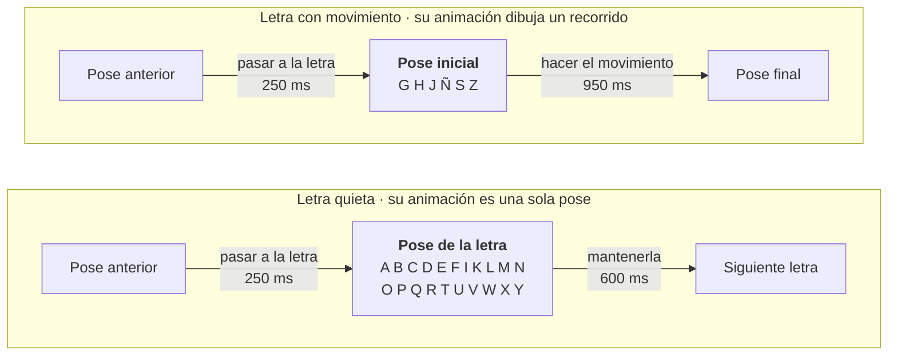

# 06 · Las animaciones de las letras

> **En pocas palabras:** cada letra es una **animación** (en inglés, *clip*) guardada dentro del
> avatar. Las animaciones **se editan a mano en Blender**: abres el avatar, eliges la letra, mueves los
> dedos y guardas. Luego exportas el avatar y la página usa la versión nueva. El paso de una letra a la
> siguiente lo calcula la página sola.

## 1. ¿Un archivo por letra o uno con todas?

| Qué se compara | A) Un archivo por letra (cada uno con el cuerpo) | B) Un archivo por avatar con todas las letras | C) El avatar + paquetes de animaciones sin cuerpo |
|---|---|---|---|
| Descargas | 27 archivos; el cuerpo se repite 27 veces | 1 archivo | El avatar + paquetes pequeños |
| Memoria | 27 cuerpos y esqueletos | 1 esqueleto | 1 esqueleto |
| Pasar de una letra a otra | Difícil: hay que cambiar de modelo | Fácil: todo está en el mismo avatar | Fácil, si los huesos se llaman igual |
| Añadir una letra | Exportar un archivo | Volver a exportar el avatar | Exportar un paquete |
| Sirve para miles de señas | ❌ | ⚠️ el archivo crece sin parar | ✅ se descarga solo lo que se usa |
| Dificultad | Media | **Baja** | Media |

### Qué se eligió

- **Hoy: opción B (ya funciona).** Un solo archivo por avatar (`public/models/avatars/<id>.glb`) con la
  pose de reposo y las 27 letras. Las animaciones ocupan ~1,5 MB porque cada una guarda los 181 huesos,
  incluidos la cara y las piernas, que no se mueven. Quitar eso queda pendiente.
- **Fase 2: opción C.** Cuando haya cientos de palabras, se crearán **paquetes de animaciones sin cuerpo**
  (por ejemplo, «saludos» o «familia») que se descargan solo cuando se necesitan. three.js los conecta al
  avatar por el **nombre de cada hueso**. La ficha de cada seña ya está preparada para esto (campo `animation.pack`).
- La opción A se descarta.

## 2. Cómo se llaman las animaciones

| Nombre | Qué es |
|---|---|
| `rest` | Pose de reposo (al empezar, al terminar o si falta una letra). **Obligatoria** |
| `idle` | (Opcional) respirar o parpadear mientras no seña |
| `sign_A` … `sign_Z` | Una por letra |
| `sign_ENYE` | La Ñ (se escribe sin «ñ» para evitar problemas con los caracteres especiales) |
| `num_0` … `num_9` | Los números (fase 1.1) |
| `word_CASA`, `word_GRACIAS` | Palabras (fase 2) |

El nombre de la animación de cada seña está escrito en sus datos, no en el código.

## 3. Dos tipos de letra



**El paso de una letra a otra no se anima a mano.** La página mezcla suavemente la pose anterior con la
nueva. Así no hay que hacer 27 × 27 = 729 transiciones.

Tiempos de partida (a velocidad normal): pasar a la letra 250 ms, mantenerla 600 ms, letras con
movimiento 950 ms. Son valores para ajustar con personas sordas; están en los datos, no en el código.
(1000 ms = 1 segundo.)

## 4. Cómo perfeccionar una letra en Blender

El **original de cada letra es su animación dentro del archivo de Blender**
(`assets-src/avatars/mpfb2/avatar.blend`). Ahí están `rest` (reposo), `sign_A` … `sign_Z` y `sign_ENYE`.
Cada animación tiene fotogramas clave solo en los **50 controles** que se mueven a mano (brazos, mano,
dedos, pulgar, palma y hombro), así que el editor de animación se ve ordenado.

### Los pasos

1. **Abre el avatar en Blender** (desde la carpeta del proyecto):

   ```bash
   npm run avatar:abrir
   ```

2. **Entra a posar:** haz clic en el esqueleto (`rig`) y pulsa `Ctrl + Tab` (*Pose Mode*).
3. **Elige la letra:** abre el *Dope Sheet*, cambia a *Action Editor* y en el menú de acciones elige la letra
   (por ejemplo `sign_L`). Ponte en el **cuadro 1**.
   - Las letras quietas tienen un solo fotograma clave (el cuadro 1).
   - Las letras con movimiento (G, H, J, Ñ, S, Z) tienen varios (por ejemplo, la J en los cuadros 1, 13, 19
     y 24). Revísalos todos.
4. **Mueve los controles** (las figuras de colores, no los huesos `DEF-` de adentro):

   | Para mover | Control |
   |---|---|
   | Un dedo completo de una vez | `f_index.01_master.R`, `f_middle.01_master.R`, `f_ring.01_master.R`, `f_pinky.01_master.R` |
   | Cada parte del dedo | `f_index.01.R`, `.02.R`, `.03.R` (igual con los demás dedos) |
   | Pulgar | `thumb.01.R`, `thumb.02.R`, `thumb.03.R` (y `thumb.01_master.R`) |
   | Palma (ahuecarla) | `palm.R` |
   | Mano y muñeca | `hand_fk.R` |
   | Giro de la palma | `forearm_fk.R` |
   | Posición del brazo | `upper_arm_fk.R` y `shoulder.R` |

   Para girar: selecciona el control, pulsa `R`, luego `X` dos veces (eje propio del hueso), escribe los
   grados y pulsa Enter. Doblar un dedo = eje X; separarlo = eje Z.
5. **Guarda la pose en la letra:** con los controles que moviste seleccionados, pulsa `I` (insertar
   fotograma clave) en el cuadro que estás editando.
6. **Revisa desde varios lados:** teclado numérico `1` (frente), `3` (lado), `7` (arriba). Para comparar,
   puedes poner una imagen de referencia detrás (*Add → Image → Reference*), por ejemplo una captura del
   video de esa letra.
7. **Guarda el archivo** con `Ctrl + S`.
8. **Exporta el avatar para la página:**

   ```bash
   npm run avatar:exportar
   ```

   Si todo sale bien, verás `[ok] public/models/avatars/mpfb2.glb` y la lista de las 28 animaciones.
   Recarga la página y revisa la letra con los botones Frente, Perfil y Mano.

Cambia el estado de la letra a «aprobada» (en `src/core/signs/alphabet.lsc.ts`) **solo** después de que la
validen personas sordas.

### De dónde salieron las animaciones

La primera versión de las 27 letras se generó con un programa a partir de ángulos escritos a mano (leídos
del dibujo del diccionario DBLSC). Desde la v0.5.0 ese archivo de ángulos y su programa ya no existen: **las
letras solo viven en Blender** y se mejoran a mano. Si alguna vez se necesitan, siguen en el historial de
git (versión v0.4.1).

### ¿Y si cambio de avatar?

Las animaciones guardan los giros de los **controles de Rigify**, que se llaman igual en cualquier avatar
hecho con Rigify. Para pasarlas a otro avatar:

1. Abre el `avatar.blend` del avatar nuevo en Blender.
2. *File → Append →* elige `assets-src/avatars/mpfb2/avatar.blend` *→ Action →* selecciona `rest` y todas
   las `sign_…`.
3. Revisa las letras: si las manos tienen proporciones parecidas funcionan casi igual; los contactos del
   pulgar (O, D, F, T) pueden necesitar un retoque.
4. Guarda y exporta (`AVATAR=otro`, ver [assets-src/README.md](../assets-src/README.md)).

### Cómo se revisó la primera versión

Se sacaron imágenes de las 27 letras, de frente y de lado, y se corrigieron las que se veían mal:

- **C, O, Q, A y X:** la mano quedaba «acostada» al girar el antebrazo. Ahora se endereza después del giro.
- **P:** la muñeca quedaba en una posición imposible. Ahora el antebrazo apunta hacia adelante.
- **H:** ahora los dedos apuntan hacia afuera y arriba, como en la ilustración.
- **L e Y:** el pulgar apuntaba hacia quien mira. Ahora queda horizontal, en el mismo plano de la palma.

Todas siguen en **borrador** hasta que las validen personas sordas.

## 5. Cómo se reproducen en el navegador

- Al cargar el avatar, todas sus animaciones se preparan en pausa y apagadas.
- En cada cuadro de la pantalla, el mezclador (`ClipDriver`):
  - va apagando la letra anterior y encendiendo la nueva, poco a poco, según cuánto ha avanzado el paso;
  - si la letra se **repite** (LL, RR, SS), pasa un momento cerca del reposo para que se vea que son dos
    letras (esto hay que validarlo con la comunidad sorda);
  - aplica la mezcla sin adelantar el tiempo, porque el reloj lo lleva el reproductor.
- La suma de lo «encendido» siempre es 100 %. Así el avatar nunca cae en la pose de fábrica con los brazos
  abiertos.

## 6. Cómo comprobar un archivo exportado

Este comando muestra cuántos huesos y qué animaciones tiene un `.glb`:

```bash
node -e "const b=require('fs').readFileSync('public/models/avatars/mpfb2.glb');const l=b.readUInt32LE(12);const j=JSON.parse(b.slice(20,20+l));console.log('joints',j.skins.map(s=>s.joints.length),'clips',j.animations.map(a=>a.name))"
```

Además, si a un avatar le falta la animación de una letra, la línea de letras de la página la muestra con
borde punteado.
