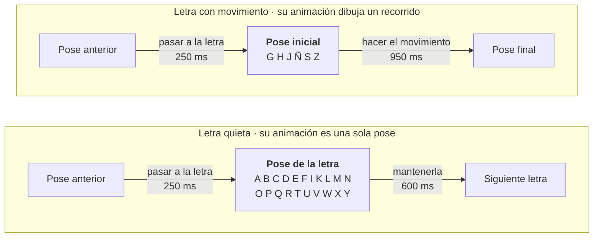

# 06 · Las animaciones de las letras

> **En pocas palabras:** cada letra es una **animación** (en inglés, *clip*) guardada dentro del
> archivo del avatar. Las letras no se animan a mano: están escritas como números (ángulos de los dedos y
> de la mano) en un archivo de datos, y un programa de Blender las convierte en animaciones para cualquier
> avatar. El paso de una letra a la siguiente lo calcula la página sola.

## 1. ¿Un archivo por letra o uno con todas?

| Qué se compara | A) Un archivo por letra (cada uno con el cuerpo) | B) Un archivo por avatar con todas las letras | C) El avatar + paquetes de animaciones sin cuerpo |
|---|---|---|---|
| Descargas | 27 archivos; el cuerpo se repite 27 veces | 1 archivo | El avatar + paquetes pequeños |
| Memoria | 27 cuerpos y esqueletos | 1 esqueleto | 1 esqueleto |
| Pasar de una letra a otra | Difícil: hay que cambiar de modelo | Fácil: todo está en el mismo avatar | Fácil, si los huesos se llaman igual |
| Añadir una letra | Exportar un archivo | Volver a exportar el avatar | Exportar un paquete |
| Sirve para miles de señas | ❌ | ⚠️ el archivo crece sin parar | ✅ se descarga solo lo que se usa |
| Dificultad | Media | **Baja** | Media |

### Qué se eligió

- **Hoy: opción B (ya funciona).** Un solo archivo por avatar (`public/models/avatars/<id>.glb`) con la
  pose de reposo y las 27 letras. Las animaciones ocupan ~1,5 MB porque cada una guarda los 181 huesos,
  incluidos la cara y las piernas, que no se mueven. Quitar eso queda pendiente.
- **Fase 2: opción C.** Cuando haya cientos de palabras, se crearán **paquetes de animaciones sin cuerpo**
  (por ejemplo, «saludos» o «familia») que se descargan solo cuando se necesitan. three.js los conecta al
  avatar por el **nombre de cada hueso**. El formato de datos ya está preparado para esto (campo
  `animation.pack`).
- La opción A se descarta.

## 2. Cómo se llaman las animaciones

| Nombre | Qué es |
|---|---|
| `rest` | Pose de reposo (al empezar, al terminar o si falta una letra). **Obligatoria** |
| `idle` | (Opcional) respirar o parpadear mientras no seña |
| `sign_A` … `sign_Z` | Una por letra |
| `sign_ENYE` | La Ñ (se escribe sin «ñ» para evitar problemas con los caracteres especiales) |
| `num_0` … `num_9` | Los números (fase 1.1) |
| `word_CASA`, `word_GRACIAS` | Palabras (fase 2) |

El nombre de la animación de cada seña está escrito en sus datos, no en el código.

## 3. Dos tipos de letra



**El paso de una letra a otra no se anima a mano.** La página mezcla suavemente la pose anterior con la
nueva. Así no hay que hacer 27 × 27 = 729 transiciones.

Tiempos de partida (a velocidad normal): pasar a la letra 250 ms, mantenerla 600 ms, letras con
movimiento 950 ms. Son valores para ajustar con personas sordas; están en los datos, no en el código.
(1000 ms = 1 segundo.)

## 4. Las letras como datos

Las 27 letras **no** se animan a mano en cada avatar. Se describen una sola vez en
`assets-src/letters/alfabeto_lsc.json`, y el programa `tools/blender/bake_letters.py` las aplica al
esqueleto de cualquier avatar Rigify. A este paso se le llama **hornear** (*bake*): convertir los datos en
animaciones guardadas dentro del avatar.

Así se ven dos letras en el archivo de datos:

```json
"L": {
  "status": "draft",
  "note": "Índice arriba y pulgar horizontal formando una L; demás cerrados.",
  "fingers": { "index": [0, 0, 0, 0], "middle": [85, 100, 60, 0], "ring": [85, 100, 60, 0], "pinky": [85, 100, 60, 0] },
  "thumb": [-30, -20, 0, 0, 0]
},
"J": {
  "fingers": { "...": "configuración de la I" },
  "motion": [ { "t": 0, "lift": 4 }, { "t": 0.5, "lift": -5 }, { "t": 1, "lift": -5, "swing": -6, "twist": 45 } ]
}
```

Qué significa cada campo (todos los ángulos en grados, mano derecha):

| Campo | Qué describe |
|---|---|
| `status` | Estado de revisión: `draft` = borrador, `approved` = aprobada por personas sordas |
| `fingers.<dedo>` | Cuatro números por dedo: cuánto se dobla cada una de sus tres partes (positivo = cerrar) y cuánto se separa (positivo = hacia el pulgar). `0` = dedo estirado |
| `thumb` | Cinco números para el pulgar: hacia el índice, hacia la palma o afuera, su giro, y cuánto se doblan sus dos partes |
| `arm.twist` | Hacia dónde mira la palma (giro del antebrazo). Con −60 la palma mira al frente; es el valor por defecto |
| `arm.hand_dir` / `arm.forearm_dir` | Hacia dónde apuntan los dedos o el antebrazo. Por ejemplo, en la P apuntan hacia abajo |
| `arm.swing` / `arm.lift` / `arm.tilt` | Mover la mano a un lado, subirla o bajarla, o inclinar el antebrazo |
| `motion` | El recorrido de las letras con movimiento (G, H, J, Ñ, S, Z): una lista de momentos, de `t: 0` (inicio) a `t: 1` (fin), con lo que cambia en cada uno |

**Comprobado:** los mismos datos produjeron las 27 letras en dos avatares distintos (el realista y uno
caricaturesco que luego se eliminó), sin cambiar nada (ver [04-diseno-avatar.md](04-diseno-avatar.md)). Lo único que puede necesitar ajustes en
un avatar con manos muy distintas son los **contactos**: el pulgar tocando otro dedo en O, D, F y T.

### Cómo corregir una letra

1. Cambia sus números en el archivo `alfabeto_lsc.json` (por ejemplo, el pulgar de la L).
2. Hornea las letras en cada avatar y expórtalo:

   ```bash
   blender -b assets-src/avatars/mpfb2/avatar.blend --python tools/blender/bake_letters.py
   ```

   ```bash
   blender -b assets-src/avatars/mpfb2/avatar.blend --python tools/blender/export_avatar.py -- public/models/avatars/mpfb2.glb
   ```

3. Revisa la letra de frente y de lado. Cambia `status` a `approved` **solo** después de que la validen
   personas sordas.

Si todo sale bien, verás algo así:

```text
[ok] Actions: ['rest', 'sign_A', 'sign_B', …, 'sign_ENYE', …, 'sign_Z']
[ok] public/models/avatars/mpfb2.glb
[clips] ['rest', 'sign_A', …, 'sign_Z']
```

Para retoques muy finos también se puede posar la mano a mano en Blender, usando la ilustración del
diccionario como referencia, y luego copiar los ángulos al archivo de datos para que la corrección sirva en
todos los avatares.

### Cómo se revisó la primera versión

Se sacaron imágenes de las 27 letras, de frente y de lado, en los dos avatares, y se corrigieron las que se
veían mal:

- **C, O, Q, A y X:** la mano quedaba «acostada» al girar el antebrazo. Ahora se endereza después del giro.
- **P:** la muñeca quedaba en una posición imposible. Ahora el antebrazo apunta hacia adelante.
- **H:** ahora los dedos apuntan hacia afuera y arriba, como en la ilustración.
- **L e Y:** el pulgar apuntaba hacia quien mira. Ahora queda horizontal, en el mismo plano de la palma.

Todas siguen en **borrador** hasta que las validen personas sordas.

El código completo de los programas está en [15-codigo-inicial.md](15-codigo-inicial.md).

## 5. Funciones para posar con código (`pose_helpers.py`)

`bake_letters.py` usa las funciones de `tools/blender/pose_helpers.py`. También sirven para probar poses
a mano:

| Función | Qué hace |
|---|---|
| `reset()` | Vuelve a la pose de reposo y quita la animación activa |
| `rot_world(hueso, eje, grados)` | Gira un hueso alrededor de un eje |
| `aim(hueso, dirección)` | Hace que un hueso apunte hacia una dirección |
| `curl(dedo, grados)` | Dobla las tres partes de un dedo |
| `arm_signing_space()` | Pone la mano derecha a la altura del hombro, con la palma al frente |
| `key_action(nombre)` | Guarda la pose actual como una animación con ese nombre |

```python
import pose_helpers as P   # con tools/blender en la ruta de Python

# Ejemplo: tres dedos cerrados (solo una prueba, NO es una letra validada)
P.reset()
P.arm_signing_space()
for f in ['f_middle', 'f_ring', 'f_pinky']:
    P.curl(f, 70)
P.key_action('sign_L')
```

Dos trampas que ya están resueltas en el archivo:

- **Los dedos y los brazos giran con sistemas distintos.** Si a un dedo se le da el giro con el sistema de
  los brazos, no se mueve.
- **Las poses se sumaban.** Si queda una animación activa, Blender la vuelve a aplicar y se suma a la nueva
  pose. Por eso `reset()` la quita.

> Estas funciones ahorran trabajo, pero **no** reemplazan la revisión contra la fuente ni la validación con
> personas que usan la LSC.

## 6. Cómo se reproducen en el navegador

- Al cargar el avatar, todas sus animaciones se preparan en pausa y apagadas.
- En cada cuadro de la pantalla, el mezclador (`ClipDriver`):
  - va apagando la letra anterior y encendiendo la nueva, poco a poco, según cuánto ha avanzado el paso;
  - si la letra se **repite** (LL, RR, SS), pasa un momento cerca del reposo para que se vea que son dos
    letras (esto hay que validarlo con la comunidad sorda);
  - aplica la mezcla sin adelantar el tiempo, porque el reloj lo lleva el reproductor.
- La suma de lo «encendido» siempre es 100 %. Así el avatar nunca cae en la pose de fábrica con los brazos
  abiertos.

## 7. Cómo comprobar un archivo exportado

Este comando muestra cuántos huesos y qué animaciones tiene un `.glb`:

```bash
node -e "const b=require('fs').readFileSync('public/models/avatars/mpfb2.glb');const l=b.readUInt32LE(12);const j=JSON.parse(b.slice(20,20+l));console.log('joints',j.skins.map(s=>s.joints.length),'clips',j.animations.map(a=>a.name))"
```

Además, si a un avatar le falta la animación de una letra, la línea de letras de la página la muestra con
borde punteado.
