# 07 · La lista de señas y el reproductor

> **En pocas palabras:** cuando escribes una palabra, la página arma una **lista de señas** (en el
> código, *AnimationQueue*): qué letra va primero, cuál después y cuánto dura cada una. Luego el
> **reproductor** recorre esa lista con su propio reloj, como un reproductor de música: puede pausar,
> seguir, detenerse, saltar a una letra, repetir y cambiar la velocidad.

Las dos piezas están en `src/core/player/`, funcionan sin pantalla y tienen pruebas automáticas.

- **La lista de señas** (`buildQueue`): qué se va a señar y cuánto dura cada cosa.
- **El reproductor** (`SignPlayer`): avanza por la lista y avisa en qué letra va.

## 1. La lista de señas

Cada elemento de la lista es **una seña** o **una pausa**:

```ts
type QueueItem =
  | { kind: 'sign';  label: 'H'; sign: SignEntry; transitionMs: 250; durationMs: 600; isRepeat: false; wordIndex: 0 }
  | { kind: 'pause'; label: '·'; reason: 'word' | 'comma' | 'sentence'; transitionMs: 0; durationMs: 450 };
```

Por ejemplo, para «Hola, Ana» la lista queda así:

```text
[ H, O, L, A, (pausa por la coma: 550 ms), A, N, A ]
```

| Elemento | Cuánto dura a velocidad normal |
|---|---|
| Letra quieta | 250 ms para llegar + 600 ms quieta = 850 ms |
| Letra con movimiento (G, H, J, Ñ, S, Z) | 250 ms + 950 ms = 1.200 ms |
| Pausa entre palabras | 450 ms |
| Pausa por coma, punto y coma o dos puntos | 550 ms |
| Pausa al final de una oración (. ! ? …) | 850 ms |

(1.000 ms = 1 segundo.)

## 2. Los estados del reproductor

El reproductor siempre está en uno de estos cuatro estados:



| Estado | En el código | Qué significa |
|---|---|---|
| En espera | `idle` | Hay una lista cargada pero no ha empezado. El avatar está en reposo |
| Reproduciendo | `playing` | El reloj avanza y el avatar seña |
| En pausa | `paused` | El reloj está quieto y el avatar se queda en la pose |
| Terminado | `ended` | Acabó la última letra. El avatar se queda en ella |

Reglas que no caben en el dibujo:

- **Cargar una lista nueva** siempre vuelve a «En espera», esté donde esté.
- **Reiniciar** es lo mismo que detener y luego reproducir.
- **Letra siguiente** y **letra anterior** son «saltar a una letra» a la de al lado.
- **Saltar a una letra mientras reproduce** sigue reproduciendo, con un paso suave. **En pausa**, muestra la
  letra elegida de inmediato.
- Con **Repetir** encendido, al terminar la última letra vuelve a empezar sin pasar por «Terminado».
- **Reproducir desde «Terminado»** empieza otra vez desde la primera letra.

## 3. Los botones y lo que hacen

| Botón o acción | Función en el código | Qué pasa |
|---|---|---|
| Reproducir | `play()` | Empieza o sigue. Si ya había terminado, vuelve a empezar |
| Pausar | `pause()` | Detiene el reloj; el avatar se queda en la pose |
| Continuar | `play()` (o `togglePlay()`) | Sigue exactamente donde estaba |
| Detener | `stop()` | Vuelve al inicio y a la pose de reposo |
| Reiniciar | `restart()` | Vuelve al inicio y reproduce |
| Velocidad | `setSpeed(…)` | 0.5x, 0.75x, 1x, 1.25x, 1.5x o 2x. Cambia al instante, incluso a mitad de una letra |
| Saltar a una letra | `seek(i)`, `next()`, `prev()` | Va a esa letra (ver las reglas de arriba) |
| Repetir | `setLoop(true)` | Al terminar, vuelve a empezar solo |

## 4. ¿Por qué el reproductor tiene su propio reloj?

La forma «obvia» sería: «reproduce la H, espera a que avise que terminó, reproduce la O…». Funciona para
reproducir, pero se complica al pausar, saltar o cambiar la velocidad, porque hay que cancelar y recalcular
esperas.

En cambio, el reproductor tiene un reloj que avanza en cada cuadro de la pantalla:

```ts
update(dtMs) {
  if (status !== 'playing') return;
  elapsedMs += dtMs * speed;                    // la velocidad multiplica el tiempo
  while (elapsedMs >= total(items[index])) {    // si pasó mucho tiempo, puede saltar varias letras
    elapsedMs -= total(items[index]);
    if (index < items.length - 1) index++;
    else if (loop) index = 0;
    else { status = 'ended'; break; }
  }
}
```

Con este reloj todo se vuelve sencillo:

- **Pausar** = no avanzar el reloj.
- **Cambiar la velocidad** = multiplicar el tiempo (a 2x, el reloj avanza el doble).
- **Saltar** = cambiar de letra y poner el reloj de esa letra en cero.

Dos detalles más:

- El reloj lo mueve un solo bucle (`usePlayerClock`). Si vuelves de otra pestaña, avanza como máximo
  100 ms de golpe, para no saltarse letras.
- Siempre da el mismo resultado. Por eso las pruebas pueden simular el tiempo sin esperar de verdad.

## 5. Dos formas de leer el estado

| | Para la pantalla (`getSnapshot()`) | Para el avatar (`getFrame()`) |
|---|---|---|
| Quién lo usa | Los botones y la línea de letras | El avatar 3D |
| Qué dice | El estado, la lista, en qué letra va, la velocidad y si repite | De qué letra viene, a cuál va y cuánto ha avanzado (de 0 a 1) |
| Cada cuánto cambia | Solo cuando cambia la letra o el estado | En cada cuadro (60 veces por segundo) |

Así los botones no se redibujan 60 veces por segundo, y el avatar se mueve con suavidad.

El avatar siempre parte de una pose real: «de qué letra viene» es la última seña anterior (las pausas se
saltan). Durante una pausa, el avatar mantiene la última letra.

## 6. Letras repetidas

Cuando una letra se repite seguida (LL, RR, SS, CC), la lista la marca como repetida. El avatar se acerca
un momento al reposo entre las dos, para que se note que son dos letras.

> ⚠️ Cómo se marca una letra repetida en LSC (un pequeño rebote, un desplazamiento a un lado, una pausa)
> **hay que validarlo** con personas sordas. Ese comportamiento está en un solo lugar del código
> (`ClipDriver.apply`), para cambiarlo con facilidad.

## 7. Cómo puede crecer

- Hoy, el reproductor avisa cuando cambia algo (`subscribe`).
- Es fácil añadir avisos como «empezó una seña» o «terminó todo», para subtítulos o estadísticas.
- Fase 2: los elementos de la lista podrán ser palabras completas; el reproductor no cambia.
- Fase 3: se podrán añadir **pistas en paralelo** (la cara, la cabeza) que usen el mismo reloj. Ver
  [16-estrategia-palabras-frases.md](16-estrategia-palabras-frases.md).

## 8. Las pruebas automáticas

Estas 15 pruebas revisan el núcleo cada vez que se ejecuta `npm test`:

```text
✓ normalizeText › deletrea HOLA
✓ normalizeText › quita tildes y diéresis pero conserva Ñ
✓ normalizeText › maneja signos de interrogación y espacios
✓ normalizeText › colapsa pausas y conserva la más fuerte
✓ normalizeText › reporta números y símbolos
✓ normalizeText › limita la longitud
✓ buildQueue › crea una seña por letra y marca repeticiones
✓ buildQueue › el alfabeto tiene 27 letras con clip
✓ SignPlayer › reproduce en orden y termina
✓ SignPlayer › pausa congela el tiempo
✓ SignPlayer › la velocidad acorta la duración
✓ SignPlayer › seek, stop, restart y loop
✓ SignPlayer › el frame de una pausa mantiene la última seña
✓ SignPlayer › saltar a una letra en pausa muestra esa letra (sin quedarse en la transición)
✓ SignPlayer › saltar mientras reproduce conserva la transición suave
Tests  15 passed (15)
```
