# 09 · De lo que escribes a lo que seña el avatar

> **En pocas palabras:** escribes una palabra y pulsas Reproducir. La página limpia el texto (mayúsculas,
> sin tildes), busca la seña de cada letra, arma la lista y el reproductor la recorre. En cada cuadro de la
> pantalla, el avatar pregunta qué pose mostrar.

## El recorrido completo



En el dibujo, **Núcleo** agrupa tres piezas: limpiar el texto, el diccionario de señas y armar la lista.

## Paso a paso

| # | Paso | Qué pasa | Dónde está en el código |
|---|---|---|---|
| 1 | Leer el texto | Al pulsar Reproducir o Enter, la página toma lo que escribiste | `App.tsx` → `spell(text)` |
| 2 | Pasar a mayúsculas | «Casa» se vuelve «CASA» | `normalizeText` |
| 3 | Separar letra por letra | Se toma cada carácter por separado, incluidos los especiales como la Ñ | `normalizeText` |
| 4 | Los espacios son pausas | Un espacio o un guion se vuelve una pausa corta. Varios seguidos cuentan como uno | `normalizeText` |
| 5 | Buscar la animación de cada letra | Para cada letra se busca su ficha en el diccionario | `buildQueue` → `SignRepository` |
| 6 | Reproducir en orden | El reproductor recorre la lista con su reloj | `SignPlayer` |
| 7 | Pasar a la siguiente | Cuando se acaba el tiempo de una letra, sigue la próxima | `SignPlayer.update` |

## Ejemplos

### HOLA

```text
letras:   H  O  L  A
lista:    [H 850 ms] [O 850 ms] [L 850 ms] [A 850 ms]     en total ≈ 3,4 segundos a velocidad normal
avatar:   reposo→H, H→O, O→L, L→A  (al final se queda en la A; Detener lo vuelve al reposo)
pantalla: H → O → L → A    Letra actual: L    3 / 4
```

### CASA

```text
C → A → S → A
La S tiene movimiento (dibuja una «S»): 250 ms para llegar + 950 ms de movimiento
```

### ¿Cómo estás?

```text
escribes:     ¿Cómo estás?
queda:        COMO ESTAS
letras:       C O M O (pausa entre palabras) E S T A S
pantalla:     C → O → M → O   E → S → T → A → S
```

Los signos `¿` y `?` no se señan. El `¿` se ignora, y el `?` del final no agrega pausa porque no hay nada
después.

### Hola, Ana 5

```text
queda:        HOLA ANA 5
lista:        H O L A (pausa por la coma: 550 ms) A N A
aviso:        «Omitidos (sin seña en el MVP): 5»
```

## Qué ve la persona

1. Debajo del campo aparece **«Se deletreará: COMO ESTAS»**. Así sabe qué se va a señar y ve que se quitaron
   las tildes y los signos.
2. El avatar empieza enseguida.
3. En la línea de letras, la letra actual se resalta en amarillo, las que ya pasaron quedan en verde claro
   y las que no tienen animación aparecen con borde punteado.
4. Tocar cualquier letra salta a ella.

## Probado en el navegador

Con las 27 letras (prueba hecha con el avatar caricaturesco, ya eliminado; el realista se comporta igual):

- «Hola Nexo» → `HOLA NEXO`: todas las letras tienen animación. Al pausar y saltar a la L, el avatar
  muestra la L con el pulgar horizontal.
- «Allá» → `ALLA`: A → L → L → A, con el pequeño regreso al reposo en la L repetida, y el contador `2 / 4`.
- «¿Hola, Ana 5?» → `HOLA ANA`, con el aviso «Omitidos: 5», el espacio entre palabras en la línea de letras
  y el contador `4 / 7`.
- Con la foto del SENA de fondo, la mano se sigue viendo bien.

Sin errores en la consola del navegador.
