# 10 · De lo que dices a lo que seña el avatar

> **En pocas palabras:** la voz es **solo otra forma de escribir**. Pulsas «Hablar», dices la palabra, el
> navegador la convierte en texto y ese texto sigue exactamente el mismo camino que si lo hubieras escrito
> (ver [09](09-flujo-texto-letras-avatar.md)).



## Se puede cambiar el motor de voz

Hoy se usa el reconocimiento de voz que trae el navegador. El código lo usa a través de un «enchufe» común
(una interfaz), así que se puede cambiar por otro motor sin tocar el resto:

```ts
interface SpeechToTextProvider {
  readonly name: string;
  isSupported(): boolean;            // ¿funciona en este navegador?
  start(lang: string, callbacks: {
    onInterim?: (text: string) => void;   // texto provisional mientras hablas
    onFinal: (text: string) => void;      // texto final
    onError?: (code: string) => void;     // si algo falla
    onEnd?: () => void;                   // cuando deja de escuchar
  }): () => void;                    // devuelve una función para detener
}
```

Para usar otro motor, se escribe uno que cumpla esta interfaz y se le pasa al botón
(`<SpeechButton provider={…} />`).

## Lo que hay que saber del reconocimiento del navegador

| Tema | Detalle |
|---|---|
| Idioma | Español de Colombia (`es-CO`). Si el navegador no lo tiene, usa español general |
| Navegadores | Chrome y Edge: sí. Safari: sí. **Firefox: no** |
| Privacidad | En Chrome, el audio se envía a servidores de Google para reconocerlo. Hay que decirlo en la política de privacidad |
| Requisitos | La página debe tener HTTPS (o ser `localhost`), y hay que dar permiso al micrófono |
| Errores | Permiso negado, no se oyó nada, sin internet o navegador sin soporte: todos muestran un mensaje en español |
| Forma de uso | Una frase cada vez que pulsas el botón, viendo el texto mientras hablas |

## Firefox y privacidad: otras opciones

| Opción | Cómo funciona | A favor | En contra |
|---|---|---|---|
| **Whisper dentro del navegador** | Se graba el audio y un modelo de IA lo convierte en texto en tu propio equipo | Funciona en Firefox, no necesita servidor y el audio no sale de tu equipo | Hay que descargar el modelo (de decenas a cientos de MB) y es más lento en equipos sencillos |
| **Servicio de voz en la nube** (Google, Azure, Deepgram, OpenAI…) | El audio se envía a un servicio que devuelve el texto | Muy preciso y funciona en cualquier navegador | Necesita un pequeño servidor para guardar la clave, cuesta por minuto y hay que cuidar los datos |

**Qué se hace hoy:** usar el reconocimiento del navegador y, donde no funcione, mostrar un mensaje claro
(«Usa Chrome o Edge, o escribe el texto»). **Primera mejora:** añadir Whisper dentro del navegador para
cuando el reconocimiento normal no esté disponible.

## Decisiones sobre la experiencia

- Al terminar de hablar, el texto aparece en el campo (así puedes ver y corregir errores) y **se reproduce
  solo**. Si en las pruebas con personas eso molesta, se cambiará a «confirmar antes de reproducir».
- Mientras escucha, el botón se pone rojo y dice «Escuchando… (toca para detener)».
- El reconocimiento puede escribir los números con cifras («tengo 3 gatos»). Hoy los números no se señan y
  se avisa; ver [11](11-manejo-caracteres-especiales.md).

## En el futuro (fase 4)

Cuando el proyecto traduzca frases completas a LSC, la parte de la voz no cambia. Solo cambia lo que pasa
después de tener el texto: en vez de deletrearlo, pasará por el traductor de la fase 3.
