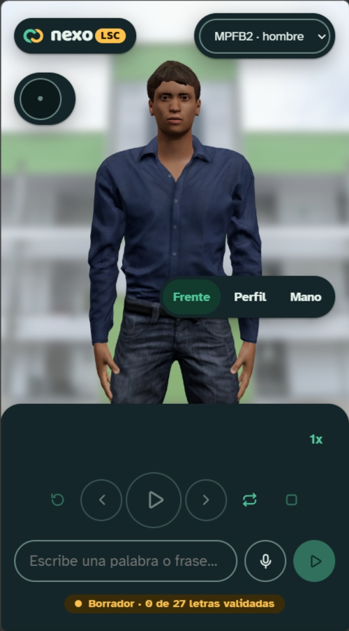

# 13 · La pantalla

> **En pocas palabras:** la pantalla usa el diseño **«Escenario»**: el avatar ocupa toda la pantalla y lo
> demás flota encima en tarjetas blancas. Arriba van el logo y el avatar elegido; a la izquierda, la letra
> que se está señando; a la derecha, los botones para mirar la mano de frente, de lado o de cerca; abajo, la
> barra para escribir y controlar la reproducción.

## Los mockups

Antes de programar la pantalla se hicieron mockups con tres opciones, cada una para escritorio y celular.
Se eligió la **opción A · Escenario**, que es la que tiene hoy la app. Las opciones B (Estudio) y C (App) quedan como referencia; de la B se podría tomar más
adelante la «ficha de la letra» (cómo se pone la mano, de qué libro sale y si ya está validada).

## Cómo se organiza la pantalla

### En el computador

### En el celular

En el celular, la velocidad es un solo botón («1x») que pasa a la siguiente velocidad en cada toque, y los
botones de abajo muestran solo el ícono (con su nombre para lectores de pantalla).

## Las piezas y dónde están en el código

| Pieza | Archivo | Qué hace |
|---|---|---|
| Pantalla completa | `src/App.tsx` | Une todo; guarda el texto; atajos de teclado |
| Logo | `src/ui/Logo.tsx` | El símbolo y el logotipo «nexo LSC» |
| Estado de validación | `ValidationBadge` en `App.tsx` | «Borrador · 0 de 27 letras validadas»; se calcula solo |
| Selector de avatar | `src/ui/AvatarSelector.tsx` | Elegir avatar; la licencia aparece al pasar el mouse y en el pie |
| Avatar 3D y fondo | `src/avatar/Avatar3D.tsx` | Muestra el avatar sobre la foto desenfocada; mueve la cámara según la vista elegida |
| Letra actual | `src/ui/CurrentLetter.tsx` | La letra grande, «3 de 4 · HOLA» y cómo se pone la mano |
| Vista de la cámara | `src/ui/CameraViews.tsx` | Botones Frente, Perfil y Mano |
| Letras de la palabra | `src/ui/LetterTimeline.tsx` | H O L A; tocar una salta a ella |
| Velocidad | `SpeedControl` en `src/ui/PlayerControls.tsx` | 0,5x a 2x |
| Controles | `PlayerControls` en `src/ui/PlayerControls.tsx` | Reiniciar, anterior, reproducir/pausar, siguiente, repetir, detener |
| Botón de voz | `src/ui/SpeechButton.tsx` | Micrófono; muestra lo que va entendiendo, el aviso y el avance de la descarga de la voz local, y los errores |

## La vista de la cámara

| Botón | Qué hace |
|---|---|
| **Frente** | Plano medio de frente: se ven la cabeza y las manos entre la cabecera y la barra inferior |
| **Perfil** | Gira la cámara al lado de la mano que seña (la derecha), para ver la forma de la mano de lado |
| **Mano** | Acerca la cámara a la mano, en la posición en la que esté en ese momento |

La cámara llega a cada vista con un movimiento corto (sin movimiento si la persona pidió menos animación en su
sistema). Después se puede seguir girando con el mouse o con el dedo.

## Cómo cambia la pantalla según lo que pasa

| Situación | Botón grande | Avatar | Letras |
|---|---|---|---|
| Sin palabra todavía | Reproducir, apagado | En reposo | No aparecen; la tarjeta dice «Escribe una palabra abajo y pulsa Reproducir» |
| Reproduciendo | Pausar | Hace la letra actual | La actual en amarillo y un poco más grande; las anteriores en verde claro |
| En pausa | Continuar | Quieto en la pose | Igual |
| Terminó | Reproducir (vuelve a empezar) | Se queda en la última letra | Todas en verde claro |
| Una letra sin animación | — | En reposo | Esa letra con borde punteado |
| No hay ningún avatar | — | La letra en grande con la descripción de la mano | Igual |
| No hay foto de fondo | — | Fondo gris claro liso | — |
| Navegador sin voz propia (Firefox, Brave) | El micrófono usa la voz local; la primera vez aparece el aviso de descarga (~85 MB) con «Descargar y hablar» y «Ahora no» | — | — |
| Descargando el modelo de voz | Barra de avance «34 de 85 MB» | — | — |
| Navegador sin micrófono ni voz | En lugar del micrófono aparece un aviso | — | — |

## Accesibilidad

- **Teclado:** `Espacio` reproduce o pausa, `←` y `→` van a la letra anterior o siguiente, `R` reinicia
  (cuando no estás escribiendo). Todos los controles son botones de verdad y muestran un anillo verde al
  recibir el foco.
- **Lectores de pantalla:** la tarjeta de la letra actual anuncia los cambios; la velocidad es un grupo de
  opciones; la letra actual está marcada como «paso actual»; los botones con solo ícono tienen su nombre.
- **Contraste:** los textos cumplen el contraste mínimo (4,5:1) y los bordes de los controles 3:1. El tema
  oscuro se activa solo si el sistema lo usa. El escenario se mantiene claro en los dos temas, porque así se
  ven mejor la piel y la ropa del avatar.
- **Tamaño para tocar:** botones y letras de al menos 44 px.
- **Letra fácil de leer:** *Atkinson Hyperlegible*, hecha para personas con baja visión (distingue bien
  `I`, `l` y `1`, y `O` y `0`).
- **Menos movimiento:** si el sistema lo pide, las letras no crecen y la cámara cambia de vista sin
  animación. El avatar sí se sigue moviendo, porque es el contenido.
- **Honestidad:** se muestra qué no se pudo señar y que las letras están en borrador. El color nunca va
  solo: cada estado lleva su palabra.

## Colores y letras (marca NexoLSC)

Sistema de diseño completo (símbolo, colores, tipografía, íconos y componentes):
<https://claude.ai/artifact/EVFLVxqZYXv6AC4Kj38ork>. En el código, los colores están como variables en
`src/styles.css`.

| Color | Claro | Oscuro | Para qué |
|---|---|---|---|
| `surface` | `#f5f9f6` | `#0c1a1c` | Fondo de la página |
| `surface-raised` | `#ffffff` | `#142629` | Tarjetas flotantes, campos y botones |
| `ink` / `ink-muted` | `#0f2a2e` / `#4a6266` | `#e8f3ee` / `#a6bbb6` | Texto principal / secundario |
| `selva` (verde) | `#0b6b4f` | `#52c99c` | Botón principal, velocidad elegida, foco |
| `mango` (amarillo) | `#ffb627` | `#ffc34d` | La letra que se está señando y la píldora «LSC» |
| `bruma` (verde claro) | `#e2f0e8` | `#123a2d` | Letras ya señadas, vista elegida |
| `arena` | `#fff3d6` | `#3a2c08` | Estado «Borrador» |
| `achiote` (rojo) | `#a8360b` | `#ff9a6b` | Errores y micrófono grabando |
| `escenario` | `#e9ecef` | igual | Fondo del avatar cuando no hay foto |

- **Letras:** *Baloo 2* (redonda) para el logo, la letra grande y las letras de la palabra; *Atkinson
  Hyperlegible* para todo lo demás.
- **Formas:** botones redondos o en píldora; tarjetas con esquinas de 24 px y una sola sombra suave.

## Foto de fondo

Detrás del avatar va la foto de la sede del SENA (`public/backgrounds/sena.jpg`). Se ajusta en
`src/avatar/stage.ts`:

| Ajuste | Valor | Por qué |
|---|---|---|
| `blurPx` (desenfoque) | 5 | El fondo da contexto, pero si se ve nítido compite con las manos |
| `veil` (velo claro) | 0.35 | Aclara la foto para que la mano sea lo que más se vea |
| `position` | `center 35%` | Qué parte de la foto queda detrás del avatar |

Regla: si en las pruebas con personas cuesta leer los dedos, sube el desenfoque o el velo antes de cambiar la
ropa o la luz del avatar.

## Ideas para después

- **Ficha de la letra** (de la opción B): descripción completa, fuente y estado de validación de cada letra.
- **Modo espejo:** ver la seña como en un espejo, para practicar.
- **Modo práctica:** el avatar hace una letra al azar y la persona adivina cuál es.
- **Widget:** el deletreador en pequeño, para ponerlo dentro de otras páginas (por ejemplo, del SENA).
