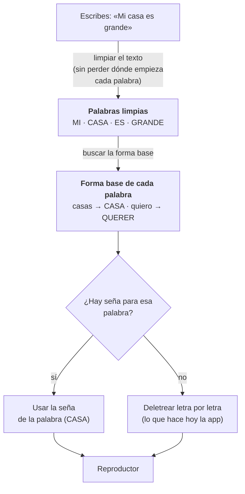
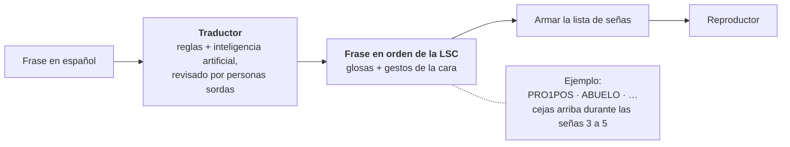

# 16 · De deletrear a señar palabras y frases

> **En pocas palabras:** hoy la app **deletrea** letra por letra. El plan es avanzar en cinco fases:
> palabras completas, frases con la gramática de la LSC, de la voz a la LSC y, al final, reconocer señas con
> la cámara. Casi todo lo que ya existe se reutiliza: el reproductor, el avatar y la forma de guardar las
> señas no hay que rehacerlos.

## Las cinco fases

| Fase | Qué hace | Ejemplo |
|---|---|---|
| **1 · Deletrear** (hoy) | Cada letra con el alfabeto manual | «Casa» → C · A · S · A |
| **2 · Palabras** | Usa la seña de la palabra si existe; si no, deletrea | «Casa» → la seña CASA |
| **3 · Frases** | Traduce al orden y la gramática de la LSC | «Mi abuelo cumplió años…» → señas en el orden de la LSC, con gestos de la cara |
| **4 · Voz** | Lo mismo que la fase 3, pero hablando | Dices la frase y el avatar la seña |
| **5 · Cámara** | Al revés: la cámara ve las señas y escribe el texto | Haces una letra y la app la reconoce |

## Qué se reutiliza en cada fase

✅ = sirve igual · 🔄 = hay que ampliarlo · — = no se usa en esa fase

| Pieza de hoy | Fase 2 · Palabras | Fase 3 · Frases | Fase 4 · Voz | Fase 5 · Cámara |
|---|---|---|---|---|
| La ficha de cada seña (`SignEntry`) | ✅ con el tipo «palabra» | ✅ + gestos de la cara | ✅ | ✅ sirve para entrenar el reconocimiento |
| El diccionario de señas (`SignRepository`) | ✅ pasa a un archivo o un servicio en internet | ✅ | ✅ | ✅ |
| Limpiar el texto (`normalizeText`) | ✅ + separar por palabras | ✅ | ✅ | — |
| Armar la lista de señas (`buildQueue`) | 🔄 busca la palabra antes de deletrear | 🔄 recibe glosas en vez de texto | 🔄 | — |
| El reproductor (`SignPlayer`) | ✅ sin cambios | ✅ + pistas en paralelo (cara, cabeza) | ✅ | — |
| El avatar y el mezclador (`ClipDriver`) | ✅ + paquetes de animaciones que se descargan al usarlos | ✅ + gestos de la cara | ✅ | — |
| Las poses como datos (`bake_letters.py`) | 🔄 se amplía a palabras (dos manos, lugar del cuerpo) | ✅ + cara y cabeza | ✅ | — |
| El reconocimiento de voz | ✅ | ✅ | ✅ | — |

## Fase 2 · Palabras completas



Qué hay que hacer:

1. **Buscar la palabra antes de deletrear.** «Armar la lista de señas» primero pregunta al diccionario si
   existe la seña de la palabra; solo si no existe, la deletrea. Es un cambio pequeño y en un solo lugar.
2. **Llevar cada palabra a su forma base** (en lingüística se llama *lema*): «casas» → CASA, «quiero» →
   QUERER. Se puede empezar con una lista de las formas más comunes y, si hace falta, usar una librería de
   procesamiento de español.
3. **Expresiones de varias palabras** («buenos días», «por favor»): buscar primero la expresión más larga
   que tenga seña.
4. **Paquetes de animaciones.** Agrupar las señas por tema (saludos, familia, colores…) en archivos sin
   cuerpo, que se descargan solo cuando se usan. three.js los conecta al avatar por el nombre de cada hueso.
5. **Pasar de una seña a la siguiente con naturalidad.** Entre palabras, la mano debe ir directo al lugar
   de la siguiente seña. Para las señas que tocan el cuerpo (la barbilla, el pecho), el brazo tendrá que
   calcular cómo llegar a ese punto mientras se reproduce. El diccionario DBLSC describe esos puntos del
   cuerpo en su Anexo 3.
6. **Un pequeño servidor.** Aquí sí hará falta: un panel para administrar las señas y su revisión, con una
   base de datos (PostgreSQL). La página no cambia: solo cambia de dónde lee el diccionario.

### Cómo producir muchas animaciones

| Forma | Calidad | Costo | Comentario |
|---|---|---|---|
| **Poses como datos + `bake_letters.py`** (lo que se usa hoy) | Media-alta; se corrige cambiando números | Bajo-medio por seña | Ya funciona con el alfabeto. Para palabras hay que añadir la mano izquierda, lugares del cuerpo y recorridos más ricos |
| Animar a mano en Blender | Alta, si hay un buen animador | Alto por seña | Para señas difíciles. Conviene pasar el resultado a datos para usarlo en todos los avatares |
| Grabar video y pasar el movimiento al avatar (MediaPipe) | Media; los dedos salen con ruido | Bajo | Grabar a personas sordas y limpiar el resultado en Blender |
| Trajes o guantes de captura de movimiento | Alta | Alto (equipos caros) | Para un grupo central de señas de muy buena calidad |
| Generar la seña desde una notación escrita (HamNoSys/SiGML, por ejemplo JASigning) | Media; se ve robótica | Bajo por seña, pero alto al empezar | Hay que escribir cada seña en esa notación |

**Recomendación:**

- Ampliar el formato de datos de las letras (`assets-src/letters/`) para las palabras: mano izquierda, lugar
  del cuerpo y recorrido. Empezar con las 100 a 200 palabras más usadas, ya validadas.
- Probar la grabación con video, **con personas sordas que den su permiso y reciban pago** por su tiempo.

**Por dónde empezar:** por los temas más útiles del diccionario DBLSC (saludos, familia, números, tiempo,
lugares) y por las palabras más comunes en el lugar donde se usará la app (por ejemplo, el SENA).

## Fase 3 · Frases con la gramática de la LSC

La LSC **no** es español con señas: tiene su propia gramática. Cambia el orden de las palabras, usa el
espacio alrededor del cuerpo y comunica también con la cara. El diccionario DBLSC lo muestra con
**glosas** (la palabra en mayúsculas con la que se escribe cada seña):

> *«Mi abuelo cumplió años el 15 de marzo»* → `PRO1POS ABUELO HACE POCO QUINCE MARZO CUMPLEAÑOS`

Cómo se haría:



- **Las glosas son el punto de encuentro** entre el traductor y el reproductor. Así, un intérprete puede
  escribir las glosas a mano (útil para revisar) y el avatar se puede probar aunque todavía no exista el
  traductor.
- **El reproductor tendrá varias pistas a la vez:** las manos, la cara y la cabeza, todas con el mismo
  reloj. La lista de señas pasa a ser una línea de tiempo con capas:

  ```ts
  interface Timeline {
    manual: QueueItem[];                                  // las señas de las manos (lo que existe hoy)
    nonManual: { track: 'face' | 'head'; clip: string; startItem: number; endItem: number }[]; // cara y cabeza
  }
  ```

- **Un traductor automático siempre debe avisar** que su resultado no está revisado y permitir que una
  persona lo corrija. Un error de traducción en lengua de señas deja a una persona sin entender: es un
  problema real de accesibilidad.

## Fase 4 · De la voz a la LSC

Ya está prevista: el reconocimiento de voz entrega el texto y desde ahí todo funciona como en la fase 3. Lo
único nuevo es partir las frases largas usando las pausas al hablar.

## Fase 5 · De la cámara al texto

Aquí el camino va al revés: la persona seña frente a la cámara y la app escribe lo que entiende.

- **Ver las manos:** MediaPipe detecta las manos y el cuerpo en el navegador (21 puntos por cada mano).
- **Letras quietas:** un modelo de inteligencia artificial las reconoce a partir de esos puntos. Un trabajo
  de la Universidad de los Llanos muestra que se puede con el alfabeto LSC.
- **Letras con movimiento y palabras:** necesitan modelos que miren el movimiento a lo largo del tiempo.
- **Las fichas de las señas** sirven para nombrar lo que se reconoce, y el avatar puede mostrar «esto es
  lo que entendí».
- **Hace falta un banco de videos propio,** grabado con el permiso informado de cada persona.

## Reglas para no tener que rehacer nada

1. La lógica de la LSC nunca va dentro de los botones ni del 3D: va en el núcleo (`src/core`).
2. Todo lo que hace el avatar pasa por el mismo camino: ficha de la seña → lista de señas → reproductor.
3. Los nombres de los huesos del avatar no se cambian: si se cambia de avatar, se conservan los nombres.
4. Cada seña guarda de dónde salió (`sources`) y si ya se revisó (`validation`).
5. Las decisiones sobre la lengua se toman **con personas sordas que usan la LSC**, no solo desde el código.

Si alguna palabra no te queda clara, búscala en el [glosario](17-glosario.md).
